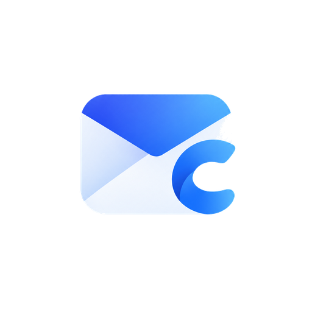

<p align="center"></p>

[English](README.md) | 简体中文

# ccmail

A quiet, focused email client for multiple accounts. Gmail, QQ Mail, 163, 126, Outlook, iCloud, enterprise mailboxes — any IMAP/SMTP service — unified into a single inbox.

[](https://github.com/CarlOpenLab/ccmail/actions/workflows/ci.yml)
[](https://github.com/CarlOpenLab/ccmail/actions/workflows/release.yml)

**[Website](https://carlopenlab.github.io/ccmail/)** · [Latest installers](https://github.com/CarlOpenLab/ccmail/releases/latest)

A Go + [mygo](https://github.com/egoist/mygo) desktop app: **the interface is drawn with mygo native controls (`github.com/egoist/mygo/ui`)** — no frontend build, no page routing; HTML bodies render inside mygo's `WebView` (system WebKit / WebView2). A single binary, with credentials stored locally under AES-256-GCM encryption.

## Quick start

Prefer not to build? Grab a macOS / Windows / Linux installer from [Releases](https://github.com/CarlOpenLab/ccmail/releases/latest).

```bash
go build -o ccmail .                    # Go 1.27+, runs directly
./ccmail                                # opens the native window

go tool mygo build                       # builds installers: macOS .app/.dmg, Windows Setup, Linux tar/deb
```

- Tested on macOS; Windows needs WebView2 (built into Win10/11), Linux needs WebKitGTK (used for HTML bodies).
- First launch shows an empty-inbox guide — click "Add mail account" to mount an account.
- Runtime data lives in `./data`; delete it for a complete reset.

## Adding real mailboxes

| Provider | IMAP | SMTP | Credentials |
|---|---|---|---|
| QQ Mail | imap.qq.com:993 | smtp.qq.com:465 | **Auth code** (web settings → Accounts → enable IMAP) |
| Gmail | imap.gmail.com:993 | smtp.gmail.com:465 | **App password** (2FA required) |
| 163 / 126 | imap.163.com:993 | smtp.163.com:465 | **Client auth password** |
| Outlook / M365 | outlook.office365.com:993 | smtp.office365.com:587 | App password |
| iCloud | imap.mail.me.com:993 | smtp.mail.me.com:587 | App-specific password |
| WeCom Mail | imap.exmail.qq.com:993 | smtp.exmail.qq.com:465 | Mailbox password |
| Alibaba Mail | imap.mxhichina.com:993 | smtp.qiye.aliyun.com:465 | Mailbox password |
| Custom | any | any | — |

The wizard connects to IMAP to verify credentials for real, then tries SMTP; once verified the account mounts immediately and syncs in the background. Accounts are color-coded, with quick switching from the title-bar avatars.

## Features

**Sending & receiving**
- Multi-account unified inbox + starred view, native list grouped by date
- IMAP IDLE push in real time; falls back to polling when unsupported
- HTML body rendering: whitelist sanitization (strips scripts / iframes / forms / `on*`), remote images blocked by default with one-click loading, inline CID images converted to data URLs
- Compose / reply / reply-all / forward; rich text editor (bold, italic, underline, lists, links, paste formatting), attachments, `⌘ + Enter` to send
- Sent mail archived automatically; star, read/unread, archive, delete, move to folder
- In-app search + unread / starred / attachment filters

**Experience**
- Native control drawing: sidebar, message list, reader, drawer-style settings, dialogs and menus
- Floating card layout: list and reader merged into one 16px card, sidebar on the window base color
- Light / dark / follow-system; graphite monochrome accents (no color themes), 4 Oklab gradient wash backgrounds
- Sidebar collapses to an icon rail (animated width transition, `⌘B`); narrow windows switch to a drawer automatically
- Settings panel: single-layer background, close button top-right; accounts (rename / recolor / remove / clear cache), appearance (theme / wash / density / reading & notifications), shortcuts, about
- Desktop notifications (sender + subject, click to focus the window), tray menu, programmatic app icon
- Keyboard flow: `J/K` navigate, `Enter` open, `N` compose, `R/A/F` reply & forward, `S` star, `E` archive, `Del` delete, `/` or `⌘K` search, `⌘B` collapse sidebar, `?` shortcuts
- Narrow-window adaptive: list / reader single-pane switching, sidebar drawer

**Privacy**
- Credentials encrypted with AES-256-GCM under a key derived from local `data/secret.key`
- Mail cache lives in `data/cache/`; no analytics, no telemetry

## Architecture

```
ccmail/
├── main.go               mygo entry: native window / tray / menus / screenshot debugging
├── internal/
│   ├── ccapp/            native UI: state, controllers, theme, per-pane views
│   │   ├── app.go        shortcuts, window background, lifecycle
│   │   ├── model.go      app state
│   │   ├── data.go       IMAP/SMTP calls, list & message loading, event subscription
│   │   ├── view.go       window skeleton and title bar
│   │   ├── sidebar.go    source list
│   │   ├── list.go       message list
│   │   ├── reader.go     reader pane and attachments
│   │   ├── compose.go    compose form and rich text editor
│   │   ├── settings.go   settings (accounts / appearance / shortcuts / about)
│   │   ├── wizard.go     add-account wizard
│   │   ├── htmlmail.go   HTML sanitization and body document
│   │   ├── palette.go    design tokens (light / dark)
│   │   ├── icons.go      SVG icon set
│   ├── mailx/            IMAP (go-imap v2): connection pool, incremental sync, parsing, flags
│   ├── smtpx/            sending (MIME building + net/smtp + Sent archiving)
│   ├── store/            account storage (JSON + AES-256-GCM)
│   ├── providers/        provider presets
│   ├── watchers/         account status, scheduled sync, IDLE, desktop notifications
│   ├── hub/              in-process event broadcast (subscribed by the native UI)
│   ├── prefs/            local preferences
│   ├── icon/             programmatically generated window / tray / installer icons
│   └── version/          app name and version
├── resources/icon.png    1024px app icon (used by mygo build)
├── mygo.json             packaging config: name, identifier, version, output dir
├── CHANGELOG.md          release notes; GitHub Releases are taken from here
└── data/                 runtime data (safe to delete for a reset)
```

- **View model**: `ui.View` builds the interface from `ccapp.App` state every frame; background goroutines post back to the main thread via `Window.Update` to mutate state and redraw.
- **Sync**: incremental sync per mailbox via UIDVALIDITY + UIDNEXT, envelopes cached locally; bodies are fetched and cached on demand, snippets fill in progressively in the background.
- **Live**: one dedicated IDLE connection per real account watching INBOX (reconnects every 25 minutes); events broadcast through `hub`, and the UI aggregates status and list refreshes.
- **Safe rendering**: HTML is sanitized through a whitelist (`internal/ccapp/htmlmail.go`) before reaching the embedded WebView; remote images become placeholders by default with manual loading, and relative links never navigate.

## Packaging & release

The version number lives in two places and must match:

- `version` in `mygo.json`: shown in packaging, installers and the in-app menu
- `Version` in `internal/version/version.go`: shown on the About page
- `CHANGELOG.md`: the `## [x.y.z]` section becomes the GitHub Release notes

Release flow (GitHub Actions, `.github/workflows/`):

```bash
# 1. Update the version numbers and CHANGELOG, commit
# 2. Tag and push — the Release workflow builds and publishes automatically
git tag v2.2.0
git push origin v2.2.0
```

After the tag is pushed:

- `create-release` validates the tag against `mygo.json` / `version.go`, creates a draft release and writes in the CHANGELOG section
- `build` runs `go tool mygo build` on macOS / Linux runners, producing `ccmail 2.2.0.dmg`, `ccmail Setup 2.2.0 amd64.exe`, `ccmail-2.2.0-linux-amd64.tar.gz`, `ccmail_2.2.0_amd64.deb`
- `publish` uploads the artifacts and publishes the draft

Installers are currently ad-hoc signed (no Developer ID / code-signing certificate): on macOS right-click → "Open" the first time, Windows shows a SmartScreen prompt. For distribution signing, add `macos.signingIdentity` / `windows.certificate` to `mygo.json` and configure the corresponding secrets.

Everyday commits and PRs run the `CI` workflow: `gofmt` / `go vet` / `go tool mygo vet` / `go test` / `go build`.

## Notes

- Gmail / QQ / 163 and friends require an "auth code / app-specific password" instead of your web login password — the wizard includes guidance for each.
- Meant for personal self-hosting; if you expose it to the public network, add your own reverse proxy and authentication.
